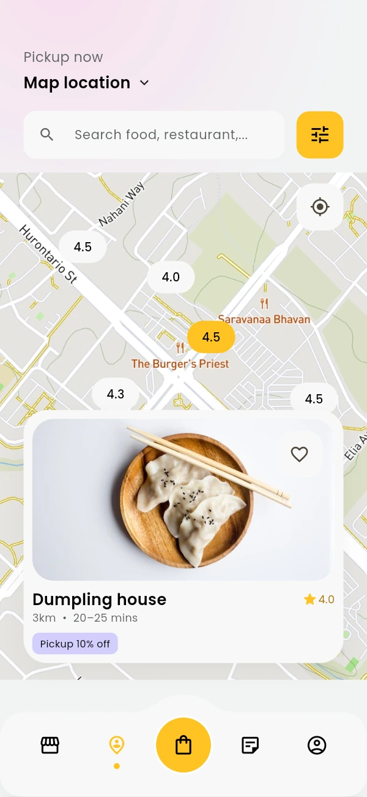
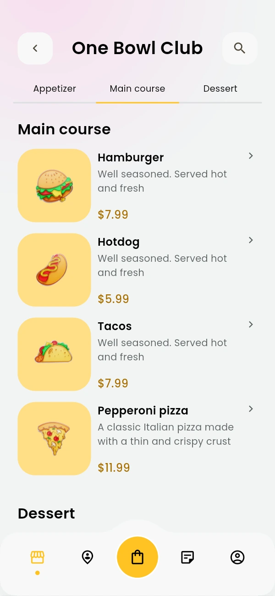
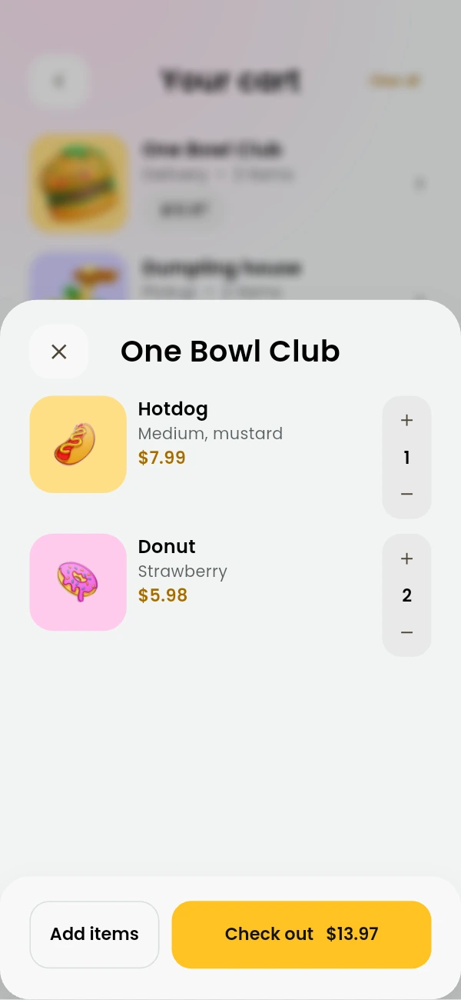
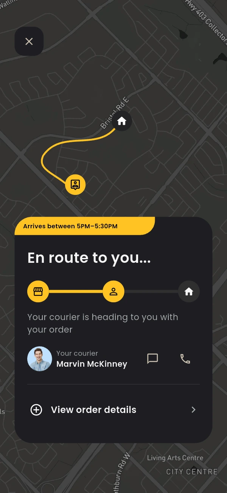
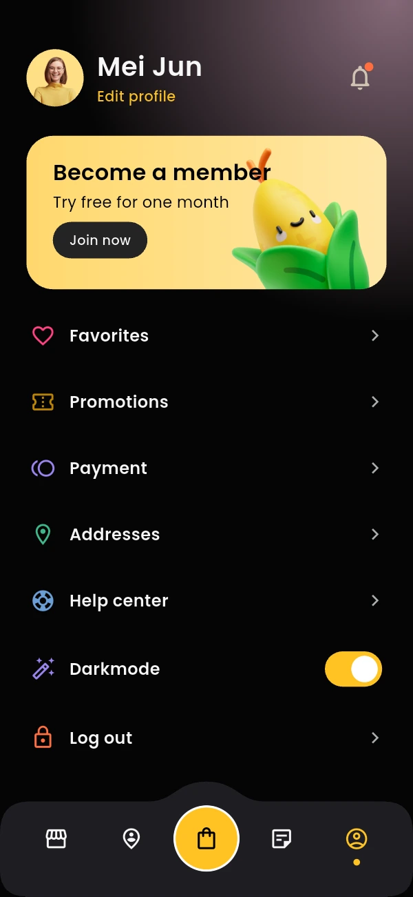

# OrderKing · Flutter 外卖与自取 App

OrderKing 是按 Pixso「OrderKing - Food delivery app」实现的 Android Flutter 项目。首页支持查找餐厅、筛选、收藏与浏览自取地图。用户可以在餐厅选餐、定制配料、修改购物车，再选择配送或自取并进入订单跟踪。在 `Account → Darkmode` 可以随时切换浅色和深色外观。

## 主要界面

截图由同一台现有 Android 11 模拟器运行 Flutter 后生成。较长的页面以 375 逻辑像素宽的长视口渲染，便于查看首屏下方的内容。全部画板可在[截图索引](docs/SCREENS.md)中按分类对照浅色、深色和 Pixso 节点。展示排版参考了 [Streamero 的 README](https://github.com/282207134/StreameroStreaming/blob/main/README.md)。

| 外卖首页 | 自取地图 | 餐厅菜单 |
| --- | --- | --- |
|  |  |  |
| **购物车** | **配送跟踪 · 深色** | **账户 · 深色** |
|  |  |  |

## 运行

使用 Flutter 3.47.7 / Dart 3.13.5 与已连接的 Android 设备。Android 构建采用 Gradle 8.14、AGP 8.11.1 和 Kotlin 2.2.20。测试复用了现有的 Android 11 x64 模拟器。

```powershell
flutter pub get
flutter devices
flutter run -d 127.0.0.1:5555
```

可跳过引导，用示例手机号 `9052360000` 与密码 `ABC2303!` 进入应用。注册使用 10 位手机号、模拟验证码 `2242` 和两次一致的至少 6 字符密码。结算可试用 `KING5`（购物车满 30 美元减 5 美元）或 `DEAL30`（指定餐厅小计减 30%）。

## 项目结构与架构

```text
OrderKingFoodDelivery/
├─ lib/
│  ├─ main.dart                    # Android 全屏启动
│  ├─ app.dart                     # MaterialApp、明暗主题和路由分发
│  ├─ core/
│  │  ├─ screen.dart               # 画板与应用路由映射
│  │  ├─ catalog.dart              # 餐厅、菜单、价格和分类示例数据
│  │  ├─ session.dart              # 会话、地址、收藏、购物车、订单和配送进度
│  │  └─ ui.dart                   # 页头、导航栏、图片、面板和表单组件
│  └─ features/
│     ├─ auth.dart                 # 启动、引导、登录和注册
│     ├─ home.dart                 # 外卖首页、搜索、筛选、自取和收藏
│     ├─ restaurant.dart           # 菜单、门店信息和餐品定制
│     ├─ cart.dart                 # 购物车、清空确认和配送/自取结算
│     ├─ delivery.dart             # 配送进度、骑手聊天和评价
│     ├─ orders.dart               # 订单历史、收据和再次购买
│     ├─ address.dart              # 地址、配送备注和地图标记
│     └─ account.dart              # 账户、会员、优惠、付款选项、帮助和通知
├─ assets/                         # Pixso 独立素材、Poppins 字体与许可
├─ android/                        # Android 工程、应用名称和启动图标
├─ test/                           # 主要流程与窄屏 Widget 测试
├─ integration_test/screens_test.dart # Android 全画板渲染与截图
├─ tool/capture.py                 # 复用现有设备并压缩保存截图
└─ docs/
   ├─ SCREENS.md                    # 截图索引
   ├─ design-manifest.json          # Pixso 浅色/深色画板名称与节点 ID
   └─ screenshots/                 # 实际 Flutter 截图
```

页面通过 `Navigator` 传递餐品或订单等参数，通过 `SessionScope` 访问共享的 `ChangeNotifier` 状态。餐厅、配送模式和餐品选项共同决定购物车分组。金额以整数分计算，结算时将餐品、价格和优惠写入订单。两个外观共用路由和组件，图片素材采用 WebP，应用没有额外的运行时包依赖。

Pixso MCP 用于读取两种外观的全部页面、参考 Flutter 导出并提取独立素材。浅色与深色各有 56 个应用画板。分组标题、组件库和样式指南用于识别界面和设计规范。应用另有一个从账户进入的收藏列表。

## 验证与截图

```powershell
flutter analyze
flutter test --concurrency=1
flutter test integration_test/screens_test.dart -d 127.0.0.1:5555
python tool/capture.py --device 127.0.0.1:5555
```

截图脚本需要 Python 和 Pillow。它用临时 ADB 端口将模拟器实际渲染结果写入 `docs/screenshots/`，运行时保留原设备分辨率与密度，完成后移除端口映射。建议依次运行本机 Widget 测试与 Android 测试，两者会生成不同目标的 Flutter 测试资源。

账户、购物车、地址、优惠、聊天和订单均为进程内演示数据，重启后恢复初始状态。地图使用 Pixso 素材，地址查询、订单进度和骑手回复在本地模拟。付款方式只记录选择与卡号后四位，支付、短信、第三方登录、骑手电话、图片发送和 PDF 下载没有接入外部服务。普通文本输入使用 Android 系统键盘，截图聚焦 Flutter 内容层。部分图标使用 Flutter 自带版本。
